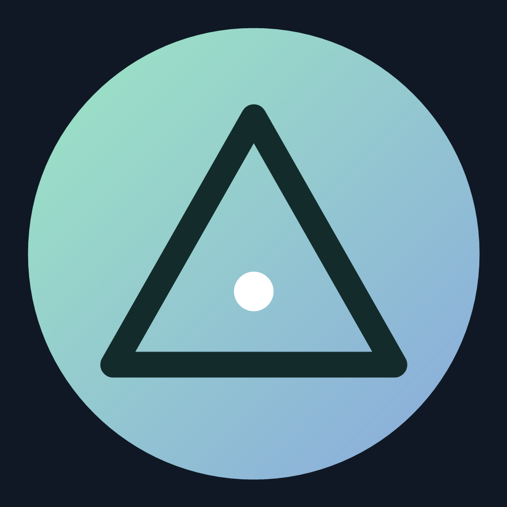

<div align="center">
  
  <h1>AI Trinity Desk</h1>
  <p><strong>三個 AI 工作夥伴，一個專注的工作空間。</strong></p>
  <p>在同一個桌面工作台使用 Claude Code、Antigravity CLI 和 Codex CLI。</p>
  <p>
    <a href="https://github.com/jimmyeyes03160729/AI-Trinity-Desk/releases">下載 Windows 版</a> ·
    <a href="#功能總覽">功能總覽</a> ·
    <a href="#從原始碼建置與測試">從原始碼建置</a>
  </p>
  <p>Windows 優先 · 支援 macOS 建置 · MIT 授權</p>
</div>

---

## 功能總覽

### 🖥️ 三個 AI，一個工作台

- **三個獨立終端**：在同一個工作台使用 Claude Code、Antigravity CLI 與 Codex CLI。每個終端都有獨立互動式 PTY，可分別啟動、停止、重啟、清屏及查看錯誤。
- **自選顯示與版面**：選擇要顯示的 AI 欄位、切換三欄或三列、拖曳調整大小及修改字體。隱藏欄位不會停止其執行中的 CLI。
- **CLI 自動安裝與環境檢查**：預設檢查並嘗試安裝缺少的官方 CLI，可關閉、取消或重試；已安裝與自訂命令不會被自動覆蓋。可設定執行檔與啟動參數，並查看安裝與啟動錯誤。AI 帳號登入仍由各 CLI 自行處理。
- **已安裝 Skills 選擇**：各欄的「Skills」可瀏覽常見使用者與目前專案目錄中的技能、搜尋用途並插入技能指令，按 Enter 前不會送出。插件、系統內建和自訂路徑的 Skills 不一定列出；可按需使用對應 CLI 將描述翻成繁體中文，翻譯會消耗用量並傳送該描述。
- **CLI 繁體中文顯示（實驗）**：Claude 與 Codex 欄位的「繁中」按鈕可轉換後續終端畫面的部分固定詞句，不修改 CLI 本體；若要翻譯啟動畫面，請先開啟再啟動 CLI。翻譯可能不完整，也可能匹配到一般輸出；關閉後後續輸出恢復原文。
- **專案資料夾**：三個 AI 可共用資料夾，或各自選擇資料夾；個別資料夾未設定時沿用共用資料夾。執行中的終端須先停止，才能切換受影響的資料夾或模式。
- **模型與用量**：選擇或手動輸入模型 ID，供下次啟動使用；支援時顯示帳號已用／剩餘比例及重置時間。可用資料依 CLI、登入方式與供應商而異，無資料不會當成零。

### 💬 讓 AI 一起討論

- **AI 互相對話**：選擇兩至三個 AI、指定回答順序、輪數與等候時間，依序傳遞回覆。可停止、接續同一場討論、延長等候或重試逾時回覆；最後一輪要求各方總結，並可在全員明確表示一致時提前停止。最新一場討論可保存與還原，也可複製紀錄。

### 🧩 找到並安裝 Skills

- **Skills 熱門市場**：瀏覽熱門排行、近期趨勢及搜尋結果，依本機專案技術訊號取得推薦；可讀取公開來源 Summary，使用所選 CLI 翻成繁體中文，並一鍵安裝至選定 AI 的 Skills 目錄，查看各 AI 的安裝狀態。

### ⚙️ 用起來順手

- **複製貼上與快捷鍵**：支援終端內複製、貼上、清屏及鍵盤操作；沒有選取文字時，Windows 的 `Ctrl+C` 保留中斷 CLI 功能。
- **設定持久化**：保存 CLI 命令、模型偏好、專案路徑、顯示欄位、版面與字體等設定；各 CLI 的登入和對話紀錄由各 CLI 管理。

## 最新更新

目前程式版本為 **1.3.0**。GitHub `main` 已加入各欄已安裝 Skills 選擇、用途翻譯，以及 Claude／Codex 實驗性繁體中文顯示。已發布的 1.3.0 安裝程式早於這些變更，想使用最新原始碼功能，請自行建置。

最新版移除了先前的各 CLI 任務側欄；各 CLI 自己的對話歷史和接續方式依該 CLI 提供的功能操作。AI 互相對話的最新一場討論仍由本程式保存。

## Windows 安裝與開始

從 [GitHub Releases](https://github.com/jimmyeyes03160729/AI-Trinity-Desk/releases) 下載 Windows x64 安裝程式。現有 1.3.0 安裝程式是較早的發布版本；若要使用 `main` 後續新增的功能，請依下方說明從最新原始碼建置。

1. 開啟程式，查看「CLI 自動安裝」面板。若設定了自訂執行檔，可在「設定」調整命令和參數。
2. 選擇共用專案資料夾，或切換「各自資料夾」為每個 AI 指定資料夾。
3. 按「環境檢查」，確認 CLI 執行檔是否存在，再按各欄的「啟動」。CLI 若要求登入或授權，依其提示操作。
4. 以「顯示欄位」選擇 AI，拖曳分隔線或切換三欄／三列調整版面。

開啟工作台不會自動啟動 CLI。自動安裝可在設定中關閉；既有 CLI 和自訂命令由使用者管理。環境檢查只確認執行檔位置，不代表帳號、網路或服務連線已驗證。

## 模型與帳號用量

在「模型與額度」選擇模型或手動輸入 ID；留空時使用各 CLI 的預設。設定供下次啟動使用，現有互動對話可依各 CLI 功能自行切換，例如輸入 `/model`。

| CLI | 模型與額度 |
| --- | --- |
| Codex CLI | 讀取可用模型；登入方式提供時可查詢帳號用量視窗與重置時間。 |
| Claude Code | 提供模型別名與手動輸入；額度可在 CLI 內使用 `/usage` 查看。 |
| Antigravity CLI | 嘗試讀取可用模型與用量；失敗時顯示原因與 CLI 操作提示。 |

供應商可能限制帳號、模型、網路或地區，安裝成功不代表服務一定能使用。AI 討論及 Summary 翻譯會使用所選 CLI 的帳號並計入相應用量。

## AI 互相對話

1. 在「AI 互相對話」輸入主題，勾選兩至三個 AI，設定回答順序、輪數和每次回覆的等待時間。
2. 開始後，各 AI 依序收到前面的討論內容；取消 Antigravity 時，Claude 與 Codex 仍可互相對話。
3. 若還有分歧，可輸入補充重點後「接續討論」；也可延長正在等待的回覆，或在逾時後重試未完成的回覆。

討論使用獨立文字工作階段，不接續各互動終端的歷史，也不以所選專案為討論目錄。主題和討論文字會送給所選 AI；最新一場討論保存在主機應用程式資料目錄中。更換參與成員需開始新討論。程式會限制傳送的歷史長度；「一致」是 AI 的表態，並非結論正確性的保證。

## Skills 市場

在「Skills 熱門市場」可查看熱門、趨勢、搜尋與專案推薦。推薦以有限範圍的本機專案技術訊號匹配，並非必裝清單；各自資料夾模式下，後端使用第一個已設定的 AI 專案資料夾，否則使用共用資料夾。切換各自資料夾後，若推薦未更新，請手動重新整理並確認畫面顯示的專案名稱。

選擇要安裝的 AI 後按「一鍵安裝」，程式從公開 GitHub 來源取得 Skill，顯示各目標的狀態與位置；既有同名內容不覆寫。安裝不會執行 Skill 腳本，也不保證 CLI 已載入或相容；安裝後依各 CLI 規則重新啟動或載入。

| AI | 使用者 Skills 目錄 |
| --- | --- |
| Claude Code | `~/.claude/skills/<skill>` |
| Codex CLI | `~/.agents/skills/<skill>` |
| Antigravity CLI | `~/.gemini/antigravity-cli/skills/<skill>` |

市場資料及 Summary 來自公開來源，可能失效或變更；中文翻譯僅供參考，請核對原文及來源。翻譯使用選定 AI 的 CLI 和帳號；專案推薦不會將專案內容或路徑送至市場。

## 終端與設定

- Windows：選取文字後按 `Ctrl+C` 複製，`Ctrl+V` 貼上；也支援 `Ctrl+Shift+C / V`。未選取文字時 `Ctrl+C` 用於中斷。
- macOS：`⌘C` 複製，`⌘V` 貼上。
- 設定中的「執行檔」填命令名稱或完整路徑；啟動參數使用 JSON 字串陣列，例如 `["--help"]`，無參數則填 `[]`。
- Windows 桌面設定通常在 `%APPDATA%\AI Trinity Desk\settings.json`，macOS 桌面設定通常在 `~/Library/Application Support/AI Trinity Desk/settings.json`。

CLI 與 PTY 以主機使用者身分執行，能存取及修改該使用者有權限存取的檔案，專案選擇範圍不是安全沙箱。不要把密碼或 API 金鑰填入會明文保存的啟動參數。自動 Git worktree 隔離尚未實作。

## 從原始碼建置與測試

需要 Node.js 22.12 以上版本與 npm，建議使用 Node.js 24。首次安裝需要網路下載依賴。

```bash
npm ci
npm run dev          # 桌面開發模式
npm test             # 單元測試
npm run test:e2e     # Electron 端到端測試
npm run build        # 桌面版建置
```

測試使用隔離的暫存資料與測試 CLI，並非實際 AI 服務驗證。

Windows 安裝程式：

```powershell
npm run dist:win -- --publish never
```

macOS 桌面版請在 macOS 上建置；Apple Silicon 和 Intel 可分別使用：

```bash
npm run dist:mac:arm64 -- --publish never
npm run dist:mac:x64 -- --publish never
```

安裝程式輸出至 `release/`。macOS 發布需另行處理 Apple 簽署與公證；macOS 尚未實機驗證。node-pty 載入失敗時，先執行 `npm run postinstall` 檢查；需要從原始碼重編時，須安裝對應平台的 C++ 建置工具後執行 `npm run rebuild:native`。

GitHub Actions 在 Windows 執行單元測試、桌面端到端測試及安裝包建置；macOS 工作流程需手動啟動。測試使用本機假 CLI 或合成資料，不等於真實供應商、帳號及所有平台均已驗證。

## 中文化來源

CLI 繁體中文顯示使用 [taekchef/claude-code-zh-cn](https://github.com/taekchef/claude-code-zh-cn) 與 [taekchef/codex-code-zh-cn](https://github.com/taekchef/codex-code-zh-cn) 的簡體翻譯資料，透過 OpenCC 轉為繁體並篩選可顯示的固定詞句；原專案採 MIT 授權，版權與授權檔見 [來源說明](vendor/localization/README.md)。此功能由 AI Trinity Desk 獨立實作，並非官方 CLI 語言包。

## 故障排除

| 問題 | 處理方式 |
| --- | --- |
| 找不到 CLI | 查看自動安裝結果，確認一般終端可啟動，或在設定填入執行檔完整路徑。 |
| CLI 立即結束 | 查看終端輸出及退出代碼，確認該 CLI 的登入、參數與網路服務。 |
| 地區或服務連線受限 | 依供應商的錯誤訊息及帳號、地區規則處理；重裝不一定能解決。 |
| 專案切換被拒絕 | 先停止受影響的終端；切換共用資料夾或模式前需停止所有終端。 |
| PTY 元件無法載入 | 重新安裝套件或應用程式；開發環境可檢查原生元件並視需要重編。 |

專案採用 [MIT 授權](LICENSE)。
